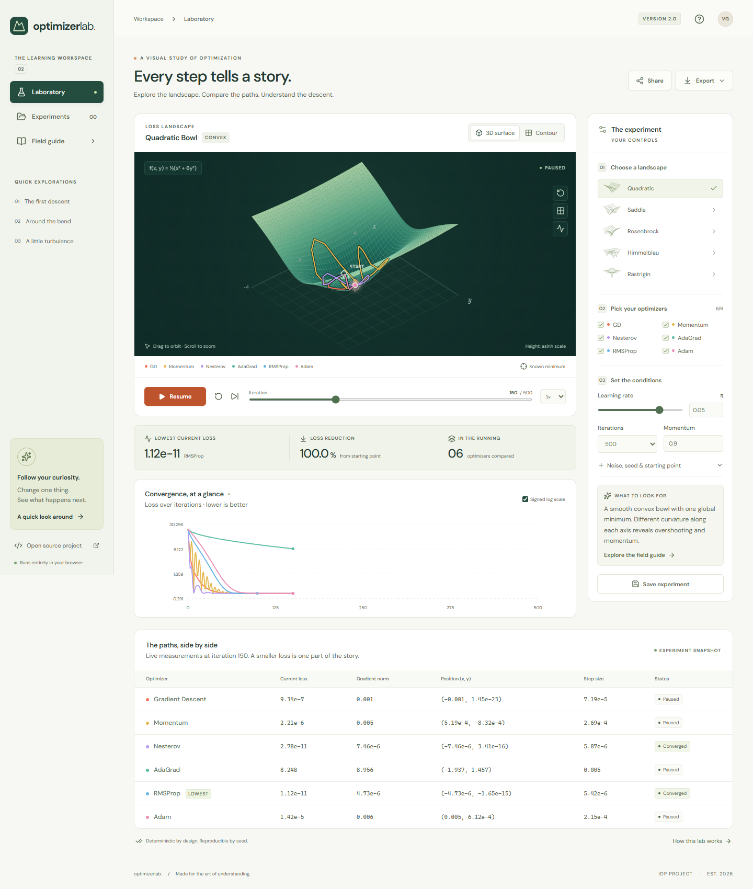

# IDP Optimizer Visual Lab

**See how optimizers think. Build an experiment. Follow every step.**

[Launch the laboratory](https://guptavernit2-afk.github.io/idp-optimizer-visual-lab/) · [How the math works](docs/methodology.md) · [Development guide](CONTRIBUTING.md)

[](https://github.com/guptavernit2-afk/idp-optimizer-visual-lab/actions/workflows/ci.yml)

A browser-based optimization laboratory that turns mathematical loss landscapes into interactive experiments. Compare six gradient-based methods on five benchmark surfaces, inspect their trajectories, and keep reproducible results for your next demonstration or report.

Originally a first-year project, the lab now brings the original 1D exploration into a modular React and TypeScript application. The original simulator remains intact in [`v1-1d-diagnostics/`](v1-1d-diagnostics/).



## What you can do

- **Explore the landscape.** Orbit and zoom a projected 3D surface, switch to a contour view, and choose a starting point.
- **Compare six methods.** Gradient Descent, Momentum, Nesterov, AdaGrad, RMSProp, and Adam use the same surface, start, and experiment budget.
- **Control the experiment.** Change learning rate, momentum, gradient noise, random seed, and step budget. Use presets to investigate common optimization behaviors.
- **Inspect the journey.** Play, pause, step, and scrub through trajectories alongside loss curves and numerical diagnostics.
- **Keep and share results.** Save experiments in this browser, export CSV traces, JSON configurations, or annotated PNG figures, and reopen an experiment from a share link.
- **Learn the mechanics.** Read the algorithm guide and the [methodology](docs/methodology.md), including the limits of each comparison.

Everything runs in your browser. The application has no backend, account requirement, API keys, or external inference service. Saved experiments belong to the current browser; export a configuration before clearing its storage.

## Run locally

Use **Node.js 22.12+** and npm.

```bash
git clone https://github.com/guptavernit2-afk/idp-optimizer-visual-lab.git
cd idp-optimizer-visual-lab
npm ci
npm run dev
```

Open the local URL printed by Vite. The archived simulator is available through the application's legacy link, or by opening [`v1-1d-diagnostics/idp_master_final.html`](v1-1d-diagnostics/idp_master_final.html) directly.

| Command                | Purpose                                                                    |
| ---------------------- | -------------------------------------------------------------------------- |
| `npm run dev`          | Start the development server                                               |
| `npm run typecheck`    | Check TypeScript without emitting files                                    |
| `npm test`             | Run numerical and data-handling tests                                      |
| `npm run test:e2e`     | Run browser interaction tests                                              |
| `npm run build`        | Create the production application in `dist/`                               |
| `npm run preview`      | Serve the production build locally                                         |
| `npm run format:check` | Verify consistent source formatting                                        |
| `npm run screenshots`  | Capture desktop, contour, guide, and mobile views from the running preview |

Run `npm run build` before browser tests. Install the test browser once with `npx playwright install chromium`; Linux environments may need `npx playwright install --with-deps chromium`. On Windows, the test configuration can use an existing Chrome installation. Set `PLAYWRIGHT_CHROMIUM_EXECUTABLE` to override the browser path.

For visual captures, start `npm run preview -- --port 4173`, then run `npm run screenshots` in a second terminal. Screenshots come from the actual application; the script also records an accessibility audit in the ignored `.cache/` directory.

## A first experiment

1. Start with the quadratic bowl and leave noise at zero.
2. Select Gradient Descent, Momentum, and Adam. Run the experiment, then scrub backward to compare their routes.
3. Increase the learning rate and observe overshoot or divergence. A failed run is useful evidence, not an error to hide.
4. Try Rosenbrock's curved valley or Rastrigin's local minima. Adjust the learning rate for each surface.
5. Save the setup or export the trace. Repeat with a fixed seed before changing one parameter at a time.

## Benchmarks and interpretation

| Landscape           | What it illustrates                               |
| ------------------- | ------------------------------------------------- |
| Quadratic bowl      | Curvature, stable descent, and momentum overshoot |
| Quartic saddle      | A saddle at the origin and two finite minima      |
| Rosenbrock valley   | A narrow curved valley with steep walls           |
| Himmelblau function | Four equal global minima and different basins     |
| Rastrigin function  | Many local minima surrounding a global minimum    |

These are educational two-parameter experiments, not a benchmark of neural-network training. One shared learning rate makes mechanisms easy to compare, but does not give every optimizer its best tuning. A small gradient alone does not prove that a global minimum was reached. Surface height is compressed for readability; exported losses and gradients retain their actual numerical values. See [methodology and equations](docs/methodology.md) for the exact conventions.

## Project structure

```text
src/
  components/             Interactive visualizations and interface components
  lib/                    Optimization engine and experiment utilities
  App.tsx                 Laboratory workspace
  main.tsx                Application entry point
public/                   Static assets
tests/                    Browser interaction tests
scripts/                  Repeatable visual verification
docs/                     Architecture, methodology, and project history
screenshots/              Actual application captures
v1-1d-diagnostics/        Preserved original 1D simulator
v2-3d-surface-lab/        Historical migration notes
.github/                  Automated checks, deployment, and contribution templates
```

The numerical engine is independent of React and rendering. This makes optimizer updates, gradients, seeded noise, and termination behavior directly testable. Read the [architecture guide](docs/architecture.md) before adding another optimizer or surface.

## Deployment

The production output is static and can be hosted on GitHub Pages or any static file host. Relative asset paths are used by default. `VITE_BASE_PATH` can override the deployment base when needed.

GitHub Actions checks the project on pushes and pull requests. After a successful `CI` run on `main`, the Pages workflow builds and publishes `dist/`; it can also be run manually. This repository is configured to use **GitHub Actions** as its Pages source. See [deployment notes](docs/deployment.md) for setup and troubleshooting.

## Contributing

See [CONTRIBUTING.md](CONTRIBUTING.md) for setup, validation, and the numerical correctness checklist. Report a problem with its surface, starting coordinates, optimizer selection, learning rate, seed, and exported configuration so it can be reproduced.

Evolved from the first-year project _A Visual and Empirical Study of Gradient Descent Optimization Variants on Benchmark Loss Surfaces_. The [project notes](docs/project-notes.md) preserve that progression.
