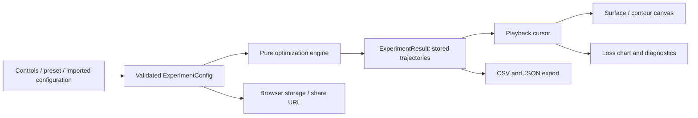

# Architecture

The application has three responsibilities: compute an experiment, present its state, and store or export the inputs and results. Numerical computation is independent of the interface and animation.

## Numerical core

[`src/lib/engine.ts`](../src/lib/engine.ts) owns surface definitions, analytic gradients, optimizer update rules, seeded noise, input validation, and termination decisions. `runExperiment` produces a configuration and one independent trajectory per selected optimizer. `normalizeConfig` validates unknown input before computation.

The result includes step `0`, so changing the playback cursor can show the initial state without rerunning the engine. Full traces are retained up to the bounded iteration budget. Runs can end early for convergence or numerical divergence; consumers must handle trajectories of different lengths.

Surface definitions contain both the objective and its gradient, display bounds, known minima, a starting point, and a suitable initial learning rate. Optimizer definitions contain stable identifiers, display names, colors, and explanatory text. Rendering code reads these definitions instead of maintaining a second list.

## Interface and rendering

React owns the experiment configuration, active workspace, playback position, and interface preferences. The loss-surface renderer lives in [`src/components/SurfaceCanvas.tsx`](../src/components/SurfaceCanvas.tsx). It projects a sampled surface onto a Canvas 2D context, supports orbiting and zooming, and draws the same stored trajectories in its surface and contour modes.

The visual height transform is intentionally separate from the objective. Camera changes, canvas resizing, and playback speed must never mutate a trajectory. High-DPI canvas sizing and a resize observer adapt the drawing to the available space. Numerical diagnostics provide a textual companion to the graphics.

## Persistence and export

The application is a static browser app. Saved experiments use local browser storage; they are not synchronized across devices. Configuration exports and share URLs carry reproducible inputs and the playback position. CSV and JSON exports include recorded points through the current playback cursor. A JSON import recomputes the full experiment from the validated configuration rather than trusting stored numerical results.

The versioned JSON envelope uses `format: "optimizer-lab/v2"`. A share URL stores the same inputs in its fragment, which is read by the application. Local storage retains up to 20 saved experiments under the `optimizer-lab.experiments.v2` key. Invalid stored entries are ignored when loading.

Storage can be unavailable or full, and clipboard access can be denied. Such failures should produce a useful interface message without losing the current experiment. Treat saved and imported content as untrusted data. Do not introduce `eval`, dynamic functions, or raw HTML injection to support custom inputs.

## Build and tests

Vite builds the static application; TypeScript checks the module boundaries. Vitest exercises the pure numerical code and data utilities. Playwright exercises the application in a headless browser. GitHub Actions runs the validation commands before deployment.

The original 1D file remains the canonical archive. The build copies it into the served `legacy/` route; the generated copy is ignored by Git. The `v2-3d-surface-lab/` directory points contributors to the current root application instead of maintaining a second implementation.

## Extending the lab

To add a surface, extend `SurfaceId` and `SURFACES`, define its gradient and meaningful reference minima, then add finite-difference checks and an appropriate starting configuration. To add an optimizer, extend `OptimizerId`, its metadata, and the update switch, then test a hand-calculated update and edge cases.

Update [methodology](methodology.md) whenever a numerical convention changes. Preserve serialized identifiers or explicitly migrate old configurations if an identifier must change. Keep dependency additions tied to a concrete need; the current numerical engine needs no runtime library.
