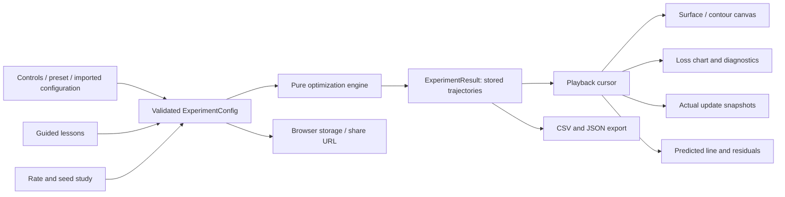

# Architecture

The application separates numerical computation, learning activities, visualization, and persistence. Every view uses the same optimizer engine; a lesson or study does not maintain a second simulation.

## Numerical core

[`src/lib/engine.ts`](../src/lib/engine.ts) owns surface definitions, analytic gradients, optimizer update rules, seeded noise, input validation, and termination decisions. `runExperiment` produces a configuration and one independent trajectory per selected optimizer. `normalizeConfig` validates unknown input before computation.

The result includes step `0`, so changing the playback cursor can show the initial state without rerunning the engine. Full traces are retained up to the bounded iteration budget. Runs can end early for convergence or numerical divergence; consumers must handle trajectories of different lengths.

Surface definitions contain both the objective and its gradient, display bounds, known minima, a starting point, and a suitable initial learning rate. Optimizer definitions contain stable identifiers, display names, colors, and explanatory text. Rendering code reads these definitions instead of maintaining a second list.

[`src/lib/regression.ts`](../src/lib/regression.ts) defines the fixed synthetic training/holdout observations, prediction and error functions, analytic gradient, and training-only least-squares reference. It supplies the sixth surface. Its gradient depends only on training observations; the holdout set is a display-time evaluation input.

Accepted trajectory points normally include independent copies of their update details. These preserve evaluation position, gradient, noise, displacement, memory, and adaptive scaling for `StepInspector`. Step zero has no update. Disabling capture with `runExperiment(config, { captureUpdates: false })` is an allocation optimization used by studies, not a different numerical mode.

## Interface and rendering

React owns the experiment configuration, active workspace, playback position, and interface preferences. The loss-surface renderer lives in [`src/components/SurfaceCanvas.tsx`](../src/components/SurfaceCanvas.tsx). It projects a sampled surface onto a Canvas 2D context, supports orbiting and zooming, and draws the same stored trajectories in its surface and contour modes.

The visual height transform is intentionally separate from the objective. Camera changes, canvas resizing, and playback speed must never mutate a trajectory. High-DPI canvas sizing and a resize observer adapt the drawing to the available space. Numerical diagnostics provide a textual companion to the graphics.

The laboratory composes `SurfaceCanvas`, `LossChart`, and `StepInspector`; selecting linear regression also mounts `RegressionPanel`. The model panel maps the same playback point to a line, residuals, and training/holdout MSE. `ExperimentNotebook` and `FieldGuide` remain separate components.

## Guided lessons and parameter studies

[`src/lib/lessons.ts`](../src/lib/lessons.ts) contains five lessons with learning objectives, prediction prompts, validated configurations, interpretation, knowledge checks, and source links. `LearningPath` requires a prediction before revealing computed evidence, then records completion after the check is answered correctly. Its estimated durations are planning aids. Lesson tests assert the actual numerical behavior discussed in the content.

[`src/lib/study.ts`](../src/lib/study.ts) validates bounded study settings, generates log-spaced rates and shared seed lists, runs each trial, and aggregates explicit valid and divergent outcomes. It retains trial summaries rather than every trajectory. Only one bounded engine result is needed at a time, with update snapshots disabled. A scheduler yields between trials so the interface can update progress and accept cancellation; `AbortSignal` and a component generation guard prevent stale work from publishing results.

`ParameterStudy` shows settings, the optimizer/rate matrix, per-seed details, and report exports. Replaying a seed builds a normal `ExperimentConfig` and opens the laboratory. Changing controls does not relabel an existing report: the report retains its completed configuration until another study runs. See [methodology](methodology.md) for survivor-median semantics and limits.

## Persistence and export

DescentLab retains the original `optimizer-lab` storage keys and JSON format identifiers for compatibility. Branding and download filenames changed; existing exported experiments and share fragments remain readable. Browser storage is origin-specific, so moving to a new hostname requires exporting experiments from the previous hostname and importing them on the new one.

The application is a static browser app. Saved experiments use local browser storage; they are not synchronized across devices. Configuration exports and share URLs carry reproducible inputs and the playback position. CSV and JSON exports include recorded points through the current playback cursor. A JSON import recomputes the full experiment from the validated configuration rather than trusting stored numerical results.

The versioned JSON envelope uses `format: "optimizer-lab/v2"`. A share URL stores the same inputs in its fragment, which is read by the application. Local storage retains up to 20 saved experiments under the `optimizer-lab.experiments.v2` key. Invalid stored entries are ignored when loading.

Learning completion stores only known lesson identifiers under `optimizer-lab.learning.v1`. It is local, ungraded progress, not a student account or transcript. Study reports use `optimizer-lab/study-v1` and are deliberately not accepted by the single-experiment importer. Both report formats retain their version markers to avoid ambiguous interpretation.

Storage can be unavailable or full, and clipboard access can be denied. Such failures should produce a useful interface message without losing the current experiment. Treat saved and imported content as untrusted data. Do not introduce `eval`, dynamic functions, or raw HTML injection to support custom inputs.

## Build and tests

Vite builds the static application; TypeScript checks the module boundaries. Vitest exercises the pure engine, captured update identities, regression objective, lesson assertions, study runner, and persistence. Playwright exercises the integrated workflows in a headless browser, including responsive layouts and automated accessibility scans. GitHub Actions runs the validation commands before deployment.

The original 1D file remains the canonical archive. The build copies it into the served `legacy/` route; the generated copy is ignored by Git. The `v2-3d-surface-lab/` directory points contributors to the current root application instead of maintaining a second implementation.

## Extending the lab

To add a surface, extend `SurfaceId` and `SURFACES`, define its gradient and meaningful reference minima, then add finite-difference checks and an appropriate starting configuration. To add an optimizer, extend `OptimizerId`, its metadata, and the update switch, then test a hand-calculated update and edge cases.

Update [methodology](methodology.md) whenever a numerical convention changes. Preserve serialized identifiers or explicitly migrate old configurations if an identifier must change. Keep dependency additions tied to a concrete need; the current numerical engine needs no runtime library.
