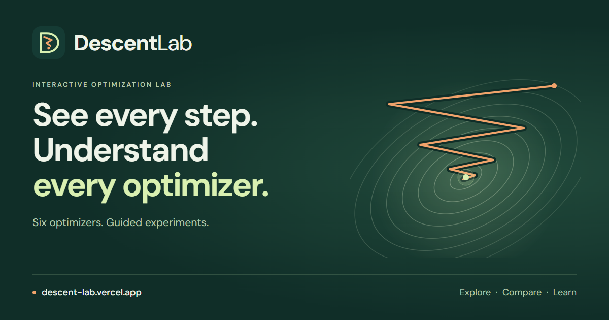

# DescentLab identity

The mark combines a **D-shaped loss basin** with a path of **shrinking optimization steps**. Its warm endpoint represents approaching a minimum. The path is a visual metaphor, not a measured optimizer trajectory.

| Asset                                                                    | Use                                             |
| ------------------------------------------------------------------------ | ----------------------------------------------- |
| [`descentlab-mark.svg`](../public/brand/descentlab-mark.svg)             | App navigation, square avatars, and small icons |
| [`descentlab-logo-light.svg`](../public/brand/descentlab-logo-light.svg) | Full logo on light backgrounds                  |
| [`descentlab-logo-dark.svg`](../public/brand/descentlab-logo-dark.svg)   | Full logo on dark backgrounds                   |
| [`favicon.svg`](../public/favicon.svg)                                   | Browser tab; the same artwork as the mark       |

The palette matches the laboratory: forest `#153B34`, sage `#D9F0B1`, and warm amber `#F0A36B`. The wordmark uses outlined DM Sans letterforms so it renders without external fonts. SVG assets scale without a raster dependency and have no scripts or remote resources.

Keep the mark square, preserve the clear space, and use the matching light or dark wordmark. The mark is designed for use from 16 pixels upward; the full logo needs enough space for its tagline. Update both the mark and favicon when changing the symbol. In the app's named home link, the mark is decorative so assistive technology announces the link only once.

## Social preview



The [1200 × 630 PNG](../public/brand/descentlab-social-v1.png) combines the logo, tagline, and an illustrative optimization path. It is served as a static public file, with Open Graph and large-image card metadata in `index.html`, so crawlers do not need JavaScript. Absolute HTTPS image URLs point to the primary Vercel site, including when the app is visited through the GitHub Pages fallback.

Regenerate the artwork after changing the logo, copy, or palette:

```bash
npm ci
npx playwright install chromium
npm run social:generate
```

The generator uses the existing SVG mark and bundled DM Sans font. It uses installed Chrome on Windows, Playwright Chromium elsewhere, or `PLAYWRIGHT_CHROMIUM_EXECUTABLE` when provided. Review the resulting PNG and commit it; deployment builds do not need a browser or image generator. For a future redesign, increment the image filename and update both image metadata URLs in `index.html` to avoid reusing a cached image.

The root page, learning pages, and experiment links share the same brand card. Experiment state stays in the original `#experiment=…` fragment; it is not sent to crawlers. Canonical and Open Graph page URLs identify the production homepage without altering navigation or shared experiment state.

Validate the deployed HTML and PNG with unauthenticated requests. Link-preview services keep their own caches, so an already shared link may retain its older card. [LinkedIn Post Inspector](https://www.linkedin.com/post-inspector/) can request a fresh scrape. See [LinkedIn's sharing requirements](https://www.linkedin.com/help/linkedin/answer/a521928) and the [Open Graph protocol](https://ogp.me/) for the metadata and image fields.
