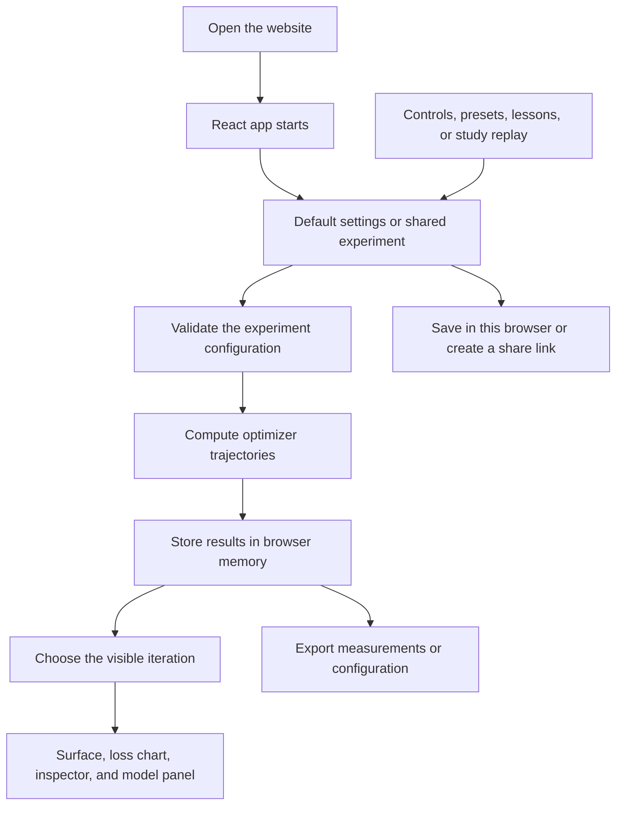
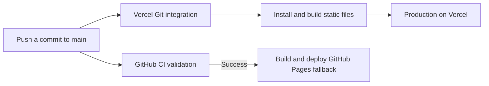

# How DescentLab works

This walkthrough follows an experiment from opening the app to inspecting and sharing its results. Read it alongside the [live laboratory](https://descent-lab.vercel.app/), then follow the linked source files when you want to understand the implementation.

## 1. The whole project in one view

DescentLab is a React and TypeScript application built with Vite. The browser calculates the optimization results, draws them, and saves experiments locally. Vercel serves the built files; there is no application backend, database, user account, or AI API behind the simulations.



Three different kinds of state matter:

| State               | Example                                        | What it affects                              |
| ------------------- | ---------------------------------------------- | -------------------------------------------- |
| Experiment settings | Learning rate, surface, start, seed            | The numerical calculation                    |
| Computed results    | Positions, losses, gradients, optimizer memory | The evidence displayed by the app            |
| Viewing controls    | Playback iteration, camera angle, chart scale  | Which results you see and how they are drawn |

**The laboratory computes trajectories when its configuration changes. Playback reveals those stored results over time.** Moving the camera or scrubbing backward does not change the mathematics.

## 2. What happens when the page opens

1. [`index.html`](../index.html) supplies the page shell, favicon, and social-sharing metadata. The empty `root` element is where React will render the interface.
2. [`src/main.tsx`](../src/main.tsx) loads the font and styles, then mounts `App`.
3. [`src/App.tsx`](../src/App.tsx) chooses the workspace from `?page=lab`, `learn`, `study`, `experiments`, or `guide`. A `#experiment=…` fragment takes priority and opens the laboratory.
4. `initialState()` reads a shared configuration, or uses `DEFAULT_CONFIG`. An invalid shared link falls back to a fresh experiment with a message.
5. The app loads the saved notebook from browser storage. It computes the initial experiment with `runExperiment(config)` and displays iteration zero.

The default experiment uses the quadratic bowl, all six optimizers, learning rate `0.05`, starting point `(-3, 2.5)`, zero gradient noise, seed `42`, and a budget of `500` steps.

## 3. Follow one optimizer step

The numerical code lives in [`src/lib/engine.ts`](../src/lib/engine.ts). Its main objects are:

| Name                | Meaning                                                                                           |
| ------------------- | ------------------------------------------------------------------------------------------------- |
| `ExperimentConfig`  | Reproducible inputs: surface, selected optimizers, rate, momentum, noise, seed, start, and budget |
| `SurfaceDefinition` | A loss function, its analytic gradient, display bounds, and known reference minima                |
| `TrajectoryPoint`   | One position with its loss, gradient norm, step size, and optional update details                 |
| `OptimizerRun`      | One optimizer's recorded points, termination status, and best recorded loss                       |
| `ExperimentResult`  | The validated configuration and all selected optimizer runs                                       |

`runExperiment()` performs this sequence:

1. Validate the inputs with `normalizeConfig()`.
2. Select the surface and generate a repeatable sequence of gradient noise from the seed. Every optimizer receives the same additive noise for a given iteration.
3. Give each optimizer its own starting position and memory. Record step zero before making an update.
4. Evaluate the gradient, add noise, apply that optimizer's rule, and calculate the next point's measurements. Nesterov evaluates its gradient at a look-ahead position.
5. Record safe points and their update details. Stop when the convergence condition, divergence limits, or iteration budget is reached.

For example, the default quadratic bowl is:

```text
Loss:                f(x, y) = 0.5 × (x² + 6y²)
Gradient:            (x, 6y)
Start:               (-3, 2.5)
Gradient at start:   (-3, 15)
Learning rate:       0.05
GD displacement:     -0.05 × (-3, 15) = (0.15, -0.75)
Next position:       (-3, 2.5) + (0.15, -0.75) = (-2.85, 1.75)
```

Try this in the lab: select **Gradient Descent**, keep noise at zero, advance to iteration one, and inspect the update. The `y` coordinate moves farther because the surface is steeper in that direction.

The other algorithms change how the displacement is calculated: Momentum retains velocity; Nesterov adds look-ahead evaluation; AdaGrad accumulates squared gradients; RMSProp uses a moving average of them; Adam combines first and second moments with bias correction. Their exact conventions are in [methodology.md](methodology.md).

Termination statuses have specific meanings:

- `completed`: the iteration budget was used. This does not assert that a minimum was reached.
- `converged`: with zero noise, the gradient and step are small and the point is close to a known reference minimum.
- `diverged`: a proposed point became non-finite or exceeded numerical safety limits. The trajectory retains its last safe point; it does not invent a valid endpoint.

## 4. How results reach the interface

In `App`, `useMemo(() => runExperiment(config), [config])` connects the current settings to the numerical engine. `updateConfig()` validates control changes, resets the playback cursor, and pauses playback. The new configuration causes a fresh calculation.

Number fields apply their draft value on Enter or when focus leaves the field; Escape cancels the draft. Invalid settings keep the current experiment intact. Reset pauses and rewinds playback while keeping the experiment settings.

The playback loop uses `requestAnimationFrame` to advance the `step` cursor. Each optimizer displays the point at that iteration, or its last recorded point if it stopped earlier.

| Component                                                      | What it does with the results                                                                  |
| -------------------------------------------------------------- | ---------------------------------------------------------------------------------------------- |
| [`SurfaceCanvas.tsx`](../src/components/SurfaceCanvas.tsx)     | Projects the surface and trajectories onto a 2D canvas; also draws the contour view            |
| [`LossChart.tsx`](../src/components/LossChart.tsx)             | Plots loss against iteration                                                                   |
| [`StepInspector.tsx`](../src/components/StepInspector.tsx)     | Explains the actual stored gradient, displacement, and optimizer memory for an accepted update |
| [`RegressionPanel.tsx`](../src/components/RegressionPanel.tsx) | Turns the current slope and intercept into predictions, residuals, and error measurements      |

Surface height is visually compressed to make large differences readable. The reported and exported numerical losses retain their original values. Step zero has no update to inspect because no movement has happened yet.

The inspector's gradient is the one used to produce the selected update, evaluated at the previous position or Nesterov's look-ahead position. The point's reported gradient norm is evaluated at the resulting position, so these measurements need not match.

## 5. The learning features reuse the same engine

**Learning path:** [`lessons.ts`](../src/lib/lessons.ts) defines five lessons and their experiments. [`LearningPath.tsx`](../src/components/LearningPath.tsx) takes a prediction, runs the lesson's configurations, reveals evidence, and checks understanding. A correct knowledge-check answer saves that lesson's completion locally. **Open in lab** transfers the configuration into the normal laboratory.

**Model fitting:** [`regression.ts`](../src/lib/regression.ts) supplies a fixed synthetic dataset and the linear-regression loss surface. Here `x` is the line's slope and `y` is its intercept. Optimization uses half the training mean squared error; the panel also shows full MSE. The 12 held-out observations are used for evaluation, not to compute the training gradient.

**Parameter studies:** [`ParameterStudy.tsx`](../src/components/ParameterStudy.tsx) collects the study settings. [`study.ts`](../src/lib/study.ts) runs all six algorithms across logarithmically spaced learning rates and repeated seeds. It keeps summaries, disables detailed update snapshots, and yields between trials to allow progress updates and cancellation. Medians exclude divergent outcomes, while failure counts remain visible. Replaying a trial opens its exact settings in the lab and computes its full trace again.

**Field guide:** [`FieldGuide.tsx`](../src/components/FieldGuide.tsx) provides algorithm explanations and references. The [teaching guide](learning-design.md) suggests a sequence for using these features together.

## 6. Saving, importing, exporting, and sharing

[`persistence.ts`](../src/lib/persistence.ts) handles the single-experiment formats and browser notebook.

| Action          | What is retained or transferred                                                                               |
| --------------- | ------------------------------------------------------------------------------------------------------------- |
| Save experiment | Name, configuration, and playback position; up to 20 entries in this browser's `localStorage`                 |
| Share link      | Configuration and playback position encoded in `#experiment=…`                                                |
| Export JSON     | Configuration, playback position, and measurements through that position                                      |
| Import JSON     | Validated configuration and position; the engine recomputes results instead of trusting imported measurements |
| Export CSV      | Measurements through the current playback position for analysis in another tool                               |
| Export PNG      | An annotated figure, produced by [`figure.ts`](../src/lib/figure.ts)                                          |

Study CSV/JSON reports use a separate format and cannot be imported as a single experiment. Lesson progress also has its own storage key.

The older `optimizer-lab` storage keys and format identifiers are intentional: they keep files and saved state compatible with the project's earlier name. Storage belongs to a browser and website origin. Localhost, Vercel, and GitHub Pages therefore have separate notebooks; JSON export/import transfers a setup between them.

Social previews come from static tags in `index.html` and the PNG in [`public/brand/`](../public/brand/). They show the general DescentLab card. The URL fragment containing an experiment stays in the browser and is not sent to a sharing crawler. See the [brand guide](brand.md) for the image-generation workflow.

## 7. Run and change the project locally

From the repository root, use Node.js **24.x**:

```bash
npm ci
npm run dev
```

Open the URL Vite prints. Edit a component or stylesheet and observe the local update. A useful first exercise is to change a heading, then follow a learning-rate change through `updateConfig()`, `runExperiment()`, and the rendered charts.

For a code change, the repository's validation sequence is:

```bash
npm run typecheck
npm run format:check
npm test
npm run build
npx playwright install chromium
npm run test:e2e
```

Vitest checks numerical and data-handling behavior. Playwright checks browser interactions and accessibility; its configuration starts a preview server for the built app. Browser installation is a setup step and need not be repeated on every edit. On Windows the configuration can use an installed Chrome; see [CONTRIBUTING.md](../CONTRIBUTING.md) for development guidance.

For your first code-reading pass, follow this order: `main.tsx` → `App.tsx` → `engine.ts` → one visualization component → `persistence.ts`. Then choose `lessons.ts`, `regression.ts`, or `study.ts` according to the feature you want to explore.

## 8. How a change reaches the live site



- [`ci.yml`](../.github/workflows/ci.yml) checks types and formatting, runs numerical tests, builds the app, and runs browser tests.
- [`pages.yml`](../.github/workflows/pages.yml) deploys the successful `main` commit to GitHub Pages. It also supports a manual run with validation.
- Vercel deploys through its repository integration using [`vercel.json`](../vercel.json). It runs independently of GitHub CI, so a successful Vercel build does not prove that every test passed.
- [`vite.config.ts`](../vite.config.ts) controls asset paths and copies the preserved original simulator into the built `/legacy/` route. `dist/` is generated output and is not committed.

Production is [descent-lab.vercel.app](https://descent-lab.vercel.app/); the fallback is [GitHub Pages](https://guptavernit2-afk.github.io/descent-lab/). Detailed hosting instructions are in [deployment.md](deployment.md).

Keep the original simulator in [`v1-1d-diagnostics/`](../v1-1d-diagnostics/) intact as project history. For deeper implementation details, continue with [architecture.md](architecture.md); for equations and interpretation limits, read [methodology.md](methodology.md).
